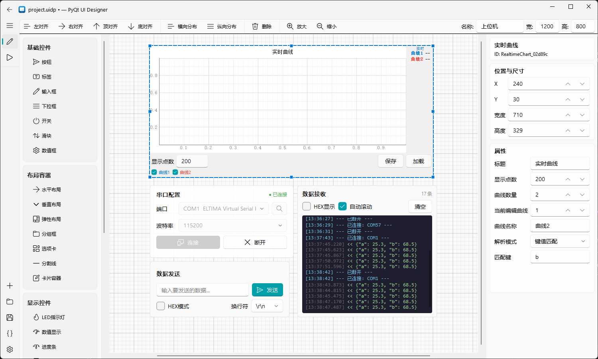
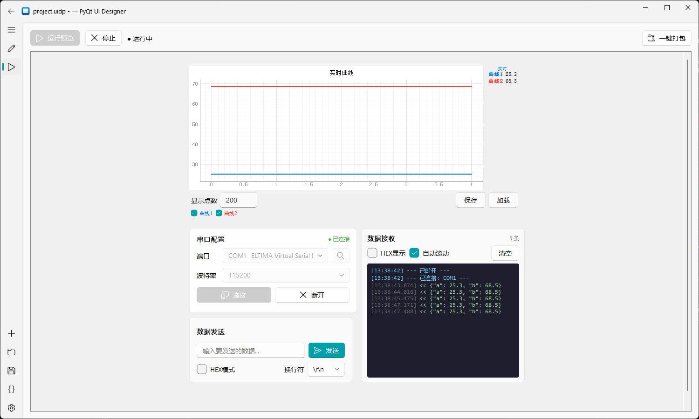

<p align="center">
  
  <h1 align="center">PyQt UI Designer</h1>
  <p align="center">面向硬件工程师的可视化上位机设计工具</p>
  <p align="center">
    <a href="https://github.com/txp666/PyQt-UI-Designer/releases/latest"></a>
    <a href="LICENSE"></a>
    
    
  </p>
  <p align="center">
    <a href="https://github.com/txp666/PyQt-UI-Designer/releases/latest"></a>
  </p>
  <p align="center">
    <a href="#通信协议支持">通信协议</a> •
    <a href="#功能特性">功能特性</a> •
    <a href="#快速开始">快速开始</a> •
    <a href="#使用说明">使用说明</a> •
    <a href="#项目结构">项目结构</a> •
    <a href="#协议文档">协议文档</a> •
    <a href="#许可证">许可证</a>
  </p>
</p>

---

> **快速体验**：从 [Releases](https://github.com/txp666/PyQt-UI-Designer/releases/latest) 下载对应平台的 zip。Windows 解压运行 `main.exe`；Apple Silicon Mac 选择 `macos-arm64`，Intel Mac 选择 `macos-x64`，解压后打开 `.app`。

**PyQt UI Designer** 是一个零代码/低代码的桌面上位机设计器。通过拖拽控件、配置属性、绑定通信数据，即可快速生成可独立运行的 PyQt5 上位机程序，并支持在 Windows 打包为 exe、在 macOS 打包为 `.app`。

## 界面预览

### 设计器界面



### 预览运行



## 通信协议支持

| 协议 | 状态 | 说明 |
|------|------|------|
| **串口 (Serial)** | ✅ 已支持 | RS-232/485/TTL，支持行文本、HEX 帧、Modbus RTU 解析 |
| **TCP Client/Server** | 🚧 开发中 | TCP Socket 通信 |
| **MQTT** | 🚧 开发中 | MQTT 发布/订阅，适用于物联网场景 |
| **UDP** | 📋 计划中 | UDP 数据报通信 |
| **Bluetooth** | 📋 计划中 | 蓝牙串口 (SPP) / BLE |

> 本项目采用模块化通信架构设计，方便扩展更多协议。欢迎贡献 PR！

## 功能特性

### 可视化设计器
- 拖拽式 UI 设计，所见即所得
- 网格吸附与对齐辅助（左对齐、右对齐、顶/底对齐、横纵分布）
- 画布大小自由设置，支持缩放
- 深色/浅色主题切换，云母效果（Win11）
- 项目文件 `.uidp` 保存与加载

### 丰富的控件库

| 分类 | 控件 |
|------|------|
| **基础控件** | 按钮、标签、输入框、下拉框、开关、滑块、数值框 |
| **布局控件** | 水平布局、垂直布局、弹性布局、分组框、选项卡、分割线、卡片容器 |
| **显示控件** | LED 指示灯、数值显示、进度条、进度环、图片显示 |
| **图表控件** | 实时曲线（多通道、游标、数据保存/加载）、仪表盘 |
| **通信控件** | 数据表格 |
| **复合控件** | 串口配置卡片、数据发送卡片、数据接收卡片、Modbus 配置卡片、日志显示框 |

### 多协议通信
- **串口**（已支持）：内置串口管理，自动扫描端口，支持多种波特率/数据位/校验位/停止位
- **TCP / MQTT / UDP / 蓝牙**：开发中，架构已预留扩展接口
- 三种数据解析模式：行文本解析、HEX 帧解析、Modbus RTU 解析
- 自动协议识别

### 数据绑定与解析
- **键值匹配**：解析 `key1:value1,key2:value2` 格式
- **JSON 路径**：解析 JSON 数据，支持嵌套路径
- **HEX 字节提取**：从二进制帧中按偏移提取数据，支持多种数据类型
- **Modbus RTU**：完整的 Modbus 寄存器解析，支持多种数据类型、字节序、功能码过滤

行文本必须以实际 LF（`\n`，也支持 CRLF）结束；接收半包时等待下一批字节，同批多帧按顺序全部处理。JSON 字符串内部的转义 `\n` 保留为内容。Modbus 正常响应和异常响应都校验 CRC，损坏帧不会更新控件。

滑块、数值框、进度条、进度环和仪表盘会忽略无法转换的数据，其中整数控件拒绝超出 Qt 整数范围的值，仪表盘拒绝 NaN/Infinity；同帧其他绑定继续更新。开关支持明确的布尔文本和数值，未知文本不改变状态；LED 自定义亮灭值优先。预览与独立导出使用相同规则，HEX 帧头尾的奇数位十六进制文本自动在前面补零。

### 命令发送
- 文本模式：带换行符选项
- HEX 模式：支持帧头帧尾、数据类型打包
- Modbus 模式：自动构建 Modbus RTU 帧，支持轮询
- 命令模板：`{value}` 占位符动态替换

### 代码导出与打包
- 一键导出为独立可运行的 Python 项目（`main.py` + `ui.py` + `serial_handler.py` + `data_binding.py` + `theme_support.py`）
- 内置 Nuitka 一键打包，实时显示编译终端输出
- 打包完成自动清理编译缓存、重命名、压缩为 zip
- 自定义上位机名称，同步到窗口标题和打包产物

## 快速开始

### 环境要求

- Python 3.10+
- Windows 10/11 或 macOS（Apple Silicon / Intel）
- 打包需本机 C/C++ 编译器：macOS 使用 Xcode Command Line Tools；Windows 使用 Nuitka 支持的编译器（Python 3.13+ 使用 MSVC）

### 安装

```bash
git clone https://github.com/txp666/PyQt-UI-Designer.git
cd PyQt-UI-Designer

# Windows 创建虚拟环境
python -m venv .venv
.venv\Scripts\activate

# 安装依赖
pip install -r requirements.txt
```

macOS 在终端执行：

```bash
git clone https://github.com/txp666/PyQt-UI-Designer.git
cd PyQt-UI-Designer
python3 -m venv .venv
source .venv/bin/activate
python -m pip install -r requirements.txt
python main.py
```

Apple Silicon 请使用原生 arm64 Python，Intel Mac 使用 x86_64 Python。依赖清单已包含 Apple Silicon 所需的 Qt 5 运行库条件；不要另行固定为只有 Intel 安装包的旧版 Qt。

### 运行

```bash
python main.py
```

### 运行独立导出示例

仓库中的 [demo](demo/README.md) 包含可编辑的 `.uidp` 工程、完整导出代码和模拟串口设备。安装依赖后，在仓库根目录运行：

```bash
python demo/simulate.py
```

选择 `DEMO` 端口并连接，即可体验温度/压力采集、双通道曲线、运行状态和命令发送，无需硬件。连接真实设备使用 `python demo/main.py`。整个 `demo` 文件夹可以复制到仓库外独立运行，协议与安装说明见 [demo/README.md](demo/README.md)。

### 打包设计器本身

```bash
python deploy.py
```

macOS 首次打包前先安装编译工具：

```bash
xcode-select --install
source .venv/bin/activate
python deploy.py
open "build/PyQt UI Designer.app"
```

输出为 `build/PyQt UI Designer.app` 和同名 zip；Windows 输出为 `build/PyQt UI Designer/main.exe` 和同名 zip。两者都包含 Python、Qt 和图标资源，运行产物无需再安装 Python。打包按本机 Python 的架构生成，不支持在 Windows 交叉编译 Mac 应用。最低 macOS 版本取决于用于构建的 Python、Qt 和编译工具，请以 Nuitka 构建日志为准。

`.app` 压缩使用 macOS `ditto`，保留可执行权限和框架符号链接。默认构建未做 Apple Developer ID 签名与公证，对外分发前需另行处理。

## 使用说明

### 1. 设计界面

在左侧控件面板中拖拽控件到画布，通过右侧属性编辑器配置控件属性。

### 2. 配置数据绑定

选中显示类控件（数值显示、LED、进度条等），在属性编辑器中设置：
- **绑定键**：对应串口数据中的字段名
- **解析模式**：选择键值匹配、JSON 路径、HEX 字节提取或 Modbus

### 3. 配置命令发送

选中交互类控件（按钮、开关、滑块等），设置：
- **发送模式**：文本、HEX 或 Modbus
- **命令内容**：要发送的数据
- **命令模板**（可选）：使用 `{value}` 占位符

### 4. 预览运行

切换到"预览运行"页面，点击"运行预览"，连接串口后即可实时测试。

串口配置卡片的“默认解析模式”可选 `line`、`hex`、`modbus` 或“项目设置”。“项目设置”使用 `.uidp` 的 `serial.parser` / `parserConfig`，默认是行文本。数据位、校验位、停止位、流控和解析模式在预览与导出程序中使用同一份实现。

实时曲线约每 33ms 批量刷新，每通道显示缓存最多 10,000 点。全部采样另存到系统临时文件，“保存”会导出完整历史 CSV/JSON，超过显示缓存的部分也会保留。清空曲线、停止预览或关闭控件后临时记录释放，请先保存需要保留的数据。大文件建议使用 CSV，CSV 加载和历史导出均按流处理。

加载历史曲线保留当前采集绑定、解析模式和通道勾选状态。已有配置的图表要求文件通道名称、数量匹配，唯一名称可以乱序；不匹配时提示错误并保留原数据。空白且未配置的默认图表仍可导入新通道。

异常数值不会中断同帧其他曲线通道，也不会写入历史。含非有限数或非法数值的历史文件会被拒绝，当前数据保持不变。JSON 在通道名唯一时仍使用名称到样本数组的对象格式；同名通道使用有序的 `name` / `values` 通道数组，避免重复键丢数据，并兼容读取旧格式。

开关、滑块和数值框支持接收数据回填；设备回填不会触发命令发送，用户操作仍按配置发送。快速断开重连时，旧连接排队的数据和错误会被忽略。

修改设计、打开其他工程或新建工程会停止旧预览并断开连接；重新运行后使用当前设计，避免发送旧命令。停止预览会释放控件及其定时器和信号连接，可连续启停。

新建、打开和退出时，会提供“保存 / 放弃 / 取消”选择。取消保存或保存失败会中止切换；项目在保存和载入前均校验，失败保留当前画布及已有文件。保存通过同目录临时文件原子替换，避免写入中断直接破坏原文件。尺寸编辑遵守控件最小宽高，多标签页独立保存布局及子控件位置。

标签名称在离开编辑框或保存、预览、导出时应用，避免输入中间状态改变控件所属页面。减少页数时，超出页的控件移到最后一页；空名称保留一个默认页。跨容器对齐使用画布坐标，自动布局中的子控件继续由布局管理。

导出会保留按钮禁用状态、输入框默认文本和只读状态、下拉框默认选项。Modbus 开关在预览和导出中都发送 FC05 写单线圈命令。

发送、接收、表格、日志和 Modbus 卡片的自定义属性会保留到导出程序；表格和日志自动接收串口数据，接收区中的 `<`、`>` 等内容按原文显示。Modbus 按钮只使用当前可见的协议设置，非法地址、数量或数值不会发送；HEX 内容、帧头尾和二进制数值在预览与导出中使用同一编码规则。

串口切换到其他解析模式时使用对应模式的配置，选择“项目设置”恢复工程配置。Modbus 卡片只有在完整写入命令后才显示“已发送”；写入失败或短写会提示失败并停止轮询，“已发送”不代表设备已确认执行。

### 5. 导出与打包

- **导出代码**：Windows 使用 `Ctrl+Shift+E`，Mac 使用 `⌘⇧E`，或点击导航栏"导出代码"
- **一键打包**：在预览页面点击"一键打包"，选择目录后自动导出 + Nuitka 编译 + 压缩

导出与打包继承设置页当前的浅色、深色或“跟随系统”模式。“跟随系统”会在独立程序启动及系统外观变化时更新。主题切换同步设计画布、运行预览、原生 Qt 控件及曲线配色，保留控件值、曲线历史、复选状态和自定义字号/颜色；接收与日志终端保持深色底以兼容已有彩色消息。

图片控件使用的本地文件会复制到导出目录的 `assets/`，随整个项目移动后仍可加载；相对图片路径以已保存工程所在目录为基准，未保存工程以当前工作目录为基准。图片文件不存在或不可读时，导出会提示错误。

导入工程的控件 ID 可包含空格、引号和中文，导出时保留为字典键。代码生成及语法检查完成后才写入目标目录，配置错误不会先覆盖已有的导出文件。

### macOS 操作

- 新建、打开、保存分别使用 `⌘N`、`⌘O`、`⌘S`。
- 选中画布控件后按 `Delete（⌫）` 删除；`Fn+Delete` 同样支持。
- 触控板双指滚动平移画布，按住 `⌘` 滚动缩放。
- 串口一般显示为 `/dev/cu.usbserial-*` 或 `/dev/cu.usbmodem*`，保留设备路径大小写；USB 转串口驱动按芯片厂商要求安装。
- “打开输出目录”使用 Finder；云母效果仅在 Windows 11 可用。
- 源码运行时，一键打包优先使用当前虚拟环境。独立 `.app` 中的一键打包仍需另外安装 Python 与编译工具；可在终端激活安装了本项目依赖的虚拟环境后启动应用。
- 找到的 Python 缺少打包依赖时，会在导出目录创建 `.build-venv` 再安装依赖，兼容 Homebrew 的系统 Python 保护机制；后续打包可复用此环境。

### 验证

```bash
python -m unittest discover -s tests -v
python tests/smoke_gui.py
```

第二项需可用的桌面会话，会打开设计器及导出的测试程序，然后自动退出。macOS 的无边框窗口依赖 Cocoa，不能用 Qt `offscreen` 插件代替原生窗口验证。

### 发布

同步 `app/common/metadata.py` 中的版本号与 `docs/release-notes/vX.Y.Z.md`，提交后推送对应的 `vX.Y.Z` 标签。GitHub Actions 会构建三个平台、验证压缩包校验值及解压后的应用启动，全部通过后才发布 GitHub Release。

## 项目结构

```
pyqtUIDesigner/
├── main.py                     # 程序入口
├── deploy.py                   # Nuitka 打包脚本
├── requirements.txt            # 依赖清单
├── demo/                       # 可独立运行的导出示例、源工程与模拟设备
├── docs/
│   └── protocol.md             # 协议文档
├── app/
│   ├── common/
│   │   ├── config.py           # 应用配置
│   │   ├── signal_bus.py       # 全局信号总线
│   │   └── style_sheet.py      # 样式表
│   ├── core/
│   │   ├── code_generator.py   # 代码导出生成器
│   │   ├── data_binding.py     # 数据绑定引擎
│   │   ├── project.py          # 项目序列化
│   │   ├── protocol_parser.py  # 协议解析器
│   │   ├── serial_manager.py   # 串口管理
│   │   └── widget_registry.py  # 控件注册表
│   ├── designer/
│   │   ├── canvas.py           # 设计画布 (Scene/View)
│   │   ├── canvas_item.py      # 画布控件项
│   │   ├── palette.py          # 控件面板
│   │   ├── property_editor.py  # 属性编辑器
│   │   └── selection_manager.py# 选择与对齐
│   ├── view/
│   │   ├── main_window.py      # 主窗口
│   │   ├── designer_interface.py # 设计器页面
│   │   ├── preview_interface.py  # 预览运行页面
│   │   └── setting_interface.py  # 设置页面
│   └── widgets/
│       ├── base.py             # 控件元数据定义
│       ├── basic.py            # 基础控件
│       ├── chart.py            # 图表控件
│       ├── comm.py             # 通信控件
│       ├── composite.py        # 复合控件
│       ├── display.py          # 显示控件
│       └── layout.py           # 布局控件
```

## 协议文档

详细的数据接收解析和命令发送协议说明请参阅 [docs/protocol.md](docs/protocol.md)。

## 技术栈

- **PyQt5** — GUI 框架
- **PyQt-Fluent-Widgets** — 现代 Fluent Design 风格控件库
- **pyqtgraph** — 高性能实时图表
- **pyserial** — 串口通信
- **Nuitka** — Python → Windows exe / macOS `.app` 编译打包

## 致谢

- [PyQt-Fluent-Widgets](https://github.com/zhiyiYo/PyQt-Fluent-Widgets) — 提供了精美的 Fluent Design 控件
- [pyqtgraph](https://github.com/pyqtgraph/pyqtgraph) — 高性能科学绘图库

## 常见问题

### Windows SmartScreen 弹出"Windows 已保护你的电脑"

这是因为 exe 没有数字签名（代码签名证书需要付费购买）。这不是病毒，点击 **"更多信息"** → **"仍要运行"** 即可。

## 许可证

本项目采用 [GPLv3](LICENSE) 许可证开源。
