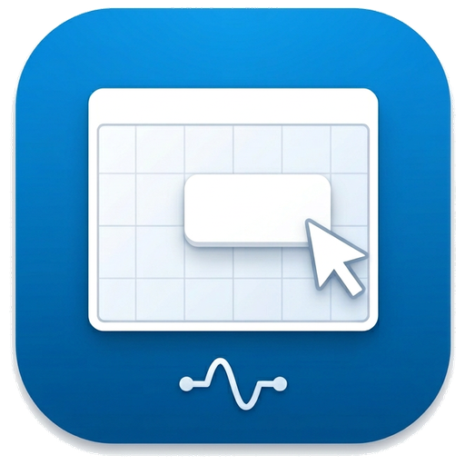
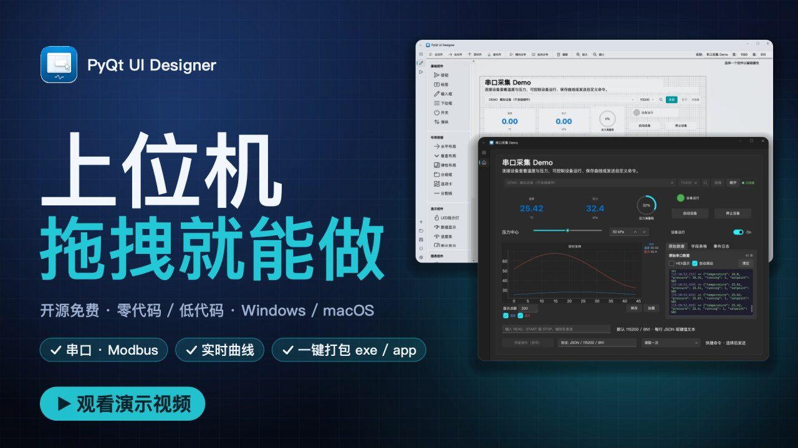
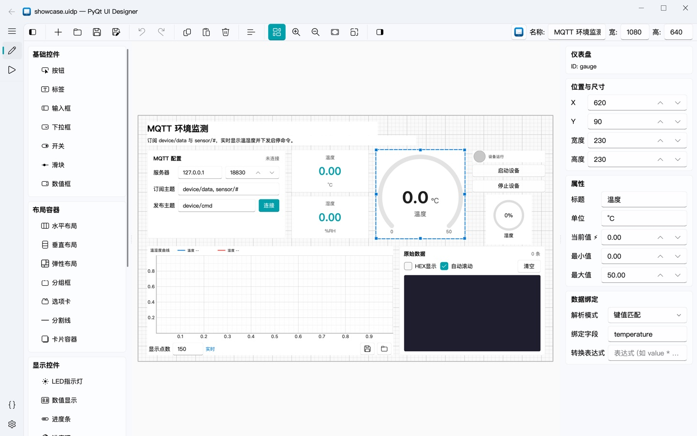
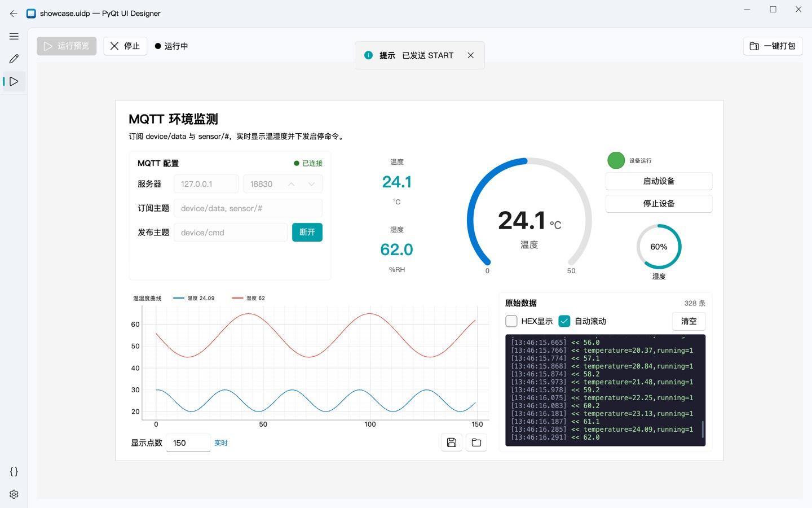

<p align="center">
  
  <h1 align="center">PyQt UI Designer</h1>
  <p align="center">面向硬件工程师的 Python 可视化上位机设计器 · 基于 <a href="https://github.com/zhiyiYo/PyQt-Fluent-Widgets">PyQt-Fluent-Widgets</a></p>
  <p align="center"><a href="README.md">English</a> · 简体中文 · <a href="https://hmi.modusignal.cn/#python">官网</a> · <a href="https://hmi.modusignal.cn/guide/">使用说明</a> · <a href="https://github.com/txp666/PyQt-UI-Designer/releases/latest">下载</a></p>
</p>

PyQt UI Designer 是 [modusignal](https://github.com/txp666/modusignal) 工具系列中的 Python/PyQt5 可视化上位机设计器。拖拽控件、配置属性并绑定串口、TCP、UDP、MQTT 或经典 S7comm 数据，然后导出**可编辑的 Python 源码**，再用 Nuitka 打包成独立的 Windows 或 macOS 应用。它与 [FluentHMI Studio](https://github.com/txp666/FluentHMI-Studio) 和 modusignal「自定义设备」中支持的功能共享 `.uidp` 格式。

> **语言**：在「设置 → 语言」中选择 English 或简体中文。

## 演示视频

<a href="https://www.bilibili.com/video/BV13KHG6VEvL"></a>

点击图片前往 B 站观看。视频演示了从拖拽设计、数据绑定、实时预览到导出打包的完整流程，画面均为软件实际运行录屏。

## 界面预览

### 设计器

拖拽控件到画布，在右侧编辑属性和数据绑定：

<picture><source media="(prefers-color-scheme: dark)" srcset="images/designer-zh-dark.jpg"></picture>

### 预览运行

同一份工程连上设备即可实时运行（图中为 MQTT 模拟设备的数据）：

<picture><source media="(prefers-color-scheme: dark)" srcset="images/preview-zh-dark.jpg"></picture>

## C++ 版 FluentHMI Studio

[FluentHMI Studio](https://github.com/txp666/FluentHMI-Studio) 是对应的原生 C++/Qt 6 设计器，界面基于 [FluentQtWidgets](https://github.com/txp666/FluentQtWidgets)。两种设计器可在各自支持的控件与协议范围内交换 `.uidp` 工程；Studio 还提供此 Python 设计器没有的原生 CAN 功能。

| 工作流 | PyQt UI Designer | FluentHMI Studio |
| --- | --- | --- |
| 导出 | 生成可编辑 Python 源码，再用 Nuitka 打包可执行应用 | 复制预编译运行时并加入工程与资源，导出不需要 Python 或编译器 |
| 预览 | 在设计器内运行，导出时生成独立代码 | 预览与导出应用使用同一个运行时 |
| 继续开发 | 修改导出的 Python 工程 | 基于 C++ 仓库开发；C++ 源码工程导出仍在路线图中 |

Studio 已包含实时曲线游标及 CSV/JSON 历史数据保存/加载。平台打包、功能范围和已有测量记录见[与 Python 版相比](https://github.com/txp666/FluentHMI-Studio/blob/main/README_zh.md#与-python-版相比)。

## 快速开始

### 下载即用

从 [Releases](https://github.com/txp666/PyQt-UI-Designer/releases/latest) 或[官网](https://hmi.modusignal.cn/#download-py)下载对应平台的压缩包。压缩包内已包含 Python 和 Qt，不需要另外安装。

| 平台 | 文件 | 运行方式 |
| --- | --- | --- |
| Windows 10/11 | `PyQt-UI-Designer-vX.Y.Z-windows-x64.zip` | 解压后运行 `main.exe` |
| macOS（Apple Silicon） | `PyQt-UI-Designer-vX.Y.Z-macos-arm64.zip` | 解压后打开 `.app` |
| macOS（Intel） | `PyQt-UI-Designer-vX.Y.Z-macos-x64.zip` | 解压后打开 `.app` |

每个压缩包都附带 `.sha256` 校验文件。安装包没有做代码签名，第一次打开时系统可能会拦截，处理方法见[常见问题](#常见问题)。

### 不接硬件，先体验一下

仓库里的 [demo](demo/README.md) 包含可编辑的 `.uidp` 工程、设计器导出的完整代码和模拟串口设备。按下文"从源码运行"安装好依赖后，在仓库根目录运行：

```bash
python demo/simulate.py
```

选择 `DEMO` 端口并连接，就能看到温度、压力采集、双通道实时曲线、运行状态和命令发送。连接真实设备时运行 `python demo/main.py`。整个 `demo` 文件夹也可以复制到仓库外独立运行。

### 从源码运行

环境要求：Python 3.10+，Windows 10/11 或 macOS（Apple Silicon / Intel）。

Windows：

```bash
git clone https://github.com/txp666/PyQt-UI-Designer.git
cd PyQt-UI-Designer
python -m venv .venv
.venv\Scripts\activate
pip install -r requirements.txt
python main.py
```

macOS：

```bash
git clone https://github.com/txp666/PyQt-UI-Designer.git
cd PyQt-UI-Designer
python3 -m venv .venv
source .venv/bin/activate
python -m pip install -r requirements.txt
python main.py
```

Apple Silicon 请使用原生 arm64 Python，Intel Mac 使用 x86_64 Python。依赖清单已包含 Apple Silicon 所需的 Qt 5 运行库条件，不要另行固定为只有 Intel 安装包的旧版 Qt。

源码使用 S7 需初始化 Snap7 子模块并运行 `python scripts/build_snap7.py` 构建平台原生库，需要 CMake、Ninja 和 C++ 编译器，见 [S7 依赖配置](docs/s7.md#build-the-native-dependency)。打包应用随附原生库。

## 功能特性

### 可视化设计

- 拖拽式 UI 设计，所见即所得
- 网格吸附与对齐辅助（左 / 右 / 顶 / 底对齐、横纵分布）
- 画布大小自由设置，支持缩放
- 深色 / 浅色主题切换，Windows 11 云母效果
- 简体中文 / 英文界面：设置页的「语言」可选跟随系统、简体中文或 English，重启后生效
- 工程文件 `.uidp` 保存与加载

### 控件库

| 分类 | 控件 |
| --- | --- |
| **基础控件** | 按钮、标签、输入框、下拉框、开关、滑块、数值框 |
| **布局控件** | 水平布局、垂直布局、弹性布局、分组框、选项卡、分割线、卡片容器 |
| **显示控件** | LED 指示灯、数值显示、进度条、进度环、图片显示 |
| **图表控件** | 实时曲线（多通道、游标、数据保存 / 加载）、仪表盘、数据表格 |
| **通信控件** | 串口配置卡片、TCP 配置卡片、UDP 配置卡片、MQTT 配置卡片、数据发送卡片、数据接收卡片、日志显示框 |
| **工业仪表** | 压力、流量、温度、液位及电量等 12 种仪表 |
| **工业设备** | 泵阀、储罐、输送、热工、执行机构和配电等 25 种设备 |
| **汽车电子** | 车载反馈、BMS 单体矩阵等 13 种控件 |
| **电子 DIY** | 旋转编码器、直流电源等 14 种控件 |
| **嵌入式** | 共享位配置的状态字、按真实采样绘制的数字时序等 14 种控件 |

[恒压供水泵站与模拟回放工程](examples/industrial)

### 数据接收与绑定

- **串口管理**：自动扫描端口，可配置波特率、数据位、校验位、停止位和流控
- **TCP 客户端 / 服务端**：客户端连接设备，或者监听端口让设备主动连入；服务端可同时接多个设备，每个连接独立切帧
- **UDP**：绑定本地端口，命令发往远程地址和端口；不填远程地址时回复最后发送方；每个数据报算一帧，每个发送方独立切帧，填广播地址即广播
- **MQTT 订阅 / 发布**：连接 broker，订阅一个或多个主题（支持 `+`、`#` 通配符）接收数据，命令发布到指定主题；支持用户名密码、QoS 0/1/2 和 TLS
- 四种链路共用同一套解析模式、数据绑定、曲线、表格和日志；命令会发往每一条已连接的链路
- 每张链路卡片有自己的一条链路，同种卡片可以放多张，各连各的：比如两个串口、一张 TCP 服务端加一张 TCP 客户端、两个 MQTT 服务器
- **键值匹配**：解析 `key1=value1,key2=value2`、JSON 顶层字段或 CSV（自动命名为 `ch0`、`ch1`…）
- **JSON 路径**：解析 JSON 数据，支持嵌套路径
- **HEX 字节提取**：从二进制帧中按偏移提取数据，支持多种数据类型
- **Modbus RTU**：完整的寄存器解析，支持多种数据类型、字节序和功能码过滤，正常响应和异常响应都校验 CRC
- **Modbus TCP**：按 MBAP 头切帧，输出与 RTU 完全相同的字典，绑定配置通用
- **Modbus ASCII**：按 `:` 和 `\r\n` 切帧并校验 LRC，输出与 RTU 相同；Modbus 命令在 `modbus_ascii` 链路上自动按 ASCII 组帧
- **按寄存器地址绑定**：本程序发出的读请求会被记下，响应里的寄存器同时按地址命名（如保持寄存器 `hr100`），绑定可选寄存器区和地址；轮询 PLC 的几块地址时数据不会串
- 串口、TCP、UDP、MQTT 都提供五种解析模式（行文本、HEX 二进制帧、Modbus RTU、Modbus TCP、Modbus ASCII），并能自动识别行协议格式；HEX 二进制帧支持帧头帧尾、长度字段、校验、定长和空闲分帧，可以在工程或每张链路卡片上分别设置

- **经典 S7comm**：使用独立 S7 连接卡片，按绝对 DB/M/I/Q 地址进行有类型读取和定向写入，BOOL 使用原生单个位写入。预览、源码导出和 Nuitka 打包共用后端，见 [S7 配置与示例](docs/s7.md)。

### 命令发送

- **文本模式**：可选换行符
- **HEX 模式**：支持帧头帧尾和数据类型打包
- **Modbus 模式**：自动组帧并支持轮询；按链路选择帧格式，解析模式为 `modbus_tcp` 的链路发 MBAP 帧，`modbus_ascii` 的链路发 ASCII 帧，其余链路发带 CRC 的 RTU 帧；支持 FC16 写多个寄存器，按数据类型写入 int16、32 位整数和 float32
- **Modbus 自动轮询**：链路卡片选 Modbus 解析、控件绑定寄存器地址即可自动读取：链路连上后程序把相邻地址并成读块，按各绑定的采集周期读取界面上看得见的控件，控件的写命令插在两次读之间，不会和读请求撞车；轮询参数（默认周期、响应超时、默认从站）在链路卡片上设置，轮询状态（无响应、设备返回的异常码）显示在链路卡片的状态栏
- **Modbus RTU / TCP 从站**：串口、TCP、UDP 卡片的 Modbus 角色选「从站」，就按设定的线圈、离散输入、保持寄存器、输入寄存器区应答外部主站（01–06、0F、10）；绑定的控件显示数据表的值，拨动控件、Modbus 写命令和从站寄存器表写进数据表，日志控件记下每个请求和应答
- **命令模板**：用 `{value}` 占位符插入控件当前的值

### 导出与打包

- 导出的独立应用会随窗口等比例缩放整张画布，控件、文字和图表一起缩放；窗口比例不同时居中留白。工程中的画布尺寸和控件坐标仍作为设计基准，已有工程无需修改；已导出的旧应用需重新导出。
- 一键导出为可独立运行的 Python 项目（`main.py`、`ui.py`、`comm_hub.py`、`serial_handler.py`、`tcp_handler.py`、`mqtt_handler.py`、`data_binding.py`、`theme_support.py`、`i18n.py`）
- 内置 Nuitka 一键打包，实时显示编译输出；完成后自动清理编译缓存、重命名并压缩为 zip
- 自定义上位机名称，会同步到窗口标题和打包产物

### 让 AI 写工程

`.uidp` 是 JSON 文件。把需求和下面这个链接一起交给 Claude、Codex 等 AI，它就能直接写出工程文件：

```text
https://raw.githubusercontent.com/txp666/PyQt-UI-Designer/main/docs/uidp-format.md
```

[Python .uidp 入口](docs/uidp-format.md) 按任务链接公共格式、专题规则和可复制模板，并提供 Python 检查、导出步骤及本地教程工程。Python 的精确控件属性见生成的[控件参考](docs/uidp-widgets.md)。写完用 `python tools/check_uidp.py 工程.uidp` 检查，再用设计器打开、预览和导出。

### 在浏览器里打开工程

[modusignal.cn 的“自定义设备”](https://modusignal.cn/#custom)能打开、编辑和运行同一个 `.uidp`，不用安装：串口卡片用浏览器的串口功能（Chrome、Edge），MQTT 卡片连 Broker 的 WebSocket 地址，TCP 卡片经 WebSocket 连接。UDP、图片控件和 Modbus 从站只能在设计器里用，导出和打包也在设计器里做。

## 通信协议支持

| 协议 | 状态 | 说明 |
| --- | --- | --- |
| **经典 S7comm** | ✅ 已支持 | S7-300/400；S7-1200/1500 的 PUT/GET 与非优化 DB，支持绝对 BOOL/BYTE/SINT/WORD/INT/DWORD/DINT/REAL，见 [S7 说明](docs/s7.md) |
| **串口（Serial）** | ✅ 已支持 | RS-232/485/TTL，支持行文本、HEX 帧、Modbus RTU 解析 |
| **TCP Client/Server** | ✅ 已支持 | TCP 客户端或服务端，服务端支持多个设备连入；解析模式与串口相同，另支持 Modbus TCP（MBAP），选 `modbus_tcp` 后 Modbus 命令自动按 MBAP 组帧 |
| **MQTT** | ✅ 已支持 | 订阅 / 发布，支持通配符主题、用户名密码、QoS 0/1/2 和 TLS；每条消息按一帧解析，纯数值载荷可按主题名绑定 |
| **UDP** | ✅ 已支持 | 本地端口加远程地址 / 端口，不填远程地址时回复最后发送方；每个数据报按一帧解析，每个发送方独立切帧；支持走 UDP 的 Modbus TCP、RTU 和 ASCII，可当主站或从站；填广播地址即广播 |

raw 通信部分采用模块化架构：串口、TCP、UDP、MQTT 实现同一组信号，由 `CommHub` 汇总后供绑定、图表、表格和日志使用，方便扩展更多协议，欢迎贡献 PR。链路细节见 [docs/protocol.md](docs/protocol.md#六传输链路串口tcpmqtt)。

## 使用说明

完整的图文说明见[官网使用说明](https://hmi.modusignal.cn/guide/)，协议格式见 [docs/protocol.md](docs/protocol.md)。

1. **设计界面**：从左侧控件面板把控件拖到画布上，在右侧属性编辑器里配置属性。
2. **绑定数据**：选中显示类控件（数值显示、LED、进度条等），设置"绑定键"（设备数据中的字段名）和"解析模式"（键值匹配、JSON 路径、HEX 字节提取、Modbus 或 S7）。
3. **配置命令**：选中交互类控件（按钮、开关、滑块等），设置发送模式（文本、HEX、JSON、Modbus 或 S7）、命令内容，以及可选的 `{value}` 命令模板。
4. **预览运行**：切换到"预览运行"页面，点击"运行预览"，用串口、TCP、UDP、MQTT 或 S7 配置卡片连接设备后即可实时测试。
5. **导出与打包**：导出代码的快捷键在 Windows 上是 `Ctrl+Shift+E`，在 Mac 上是 `⌘⇧E`，也可以点击导航栏的"导出代码"；在预览页面点击"一键打包"，选择目录后会自动导出、用 Nuitka 编译并压缩。打包需要本机有 C/C++ 编译器：macOS 使用 Xcode Command Line Tools，Windows 使用 Nuitka 支持的编译器（Python 3.13+ 使用 MSVC）。

<details>
<summary><b>数据解析规则</b></summary>

行文本以行结束符结束（默认 LF `\n`，也支持 CRLF，可在帧格式里改成 `;` 等）；JSON 按括号配对分条，不需要结束符；接收半包时等待下一批字节，同批多帧按顺序全部处理。JSON 字符串内部的转义 `\n` 保留为内容。Modbus 正常响应和异常响应都校验 CRC，损坏帧不会更新控件。

滑块、数值框、进度条、进度环和仪表盘会忽略无法转换的数据，其中整数控件拒绝超出 Qt 整数范围的值，仪表盘拒绝 NaN/Infinity；同帧其他绑定继续更新。开关支持明确的布尔文本和数值，未知文本不改变状态；LED 自定义亮灭值优先。预览与独立导出使用相同规则，HEX 帧头尾的奇数位十六进制文本自动在前面补零。

串口、TCP、UDP 和 MQTT 配置卡片的"默认解析模式"可选 `line`、`hex`、`modbus`、`modbus_tcp`、`modbus_ascii` 或"项目设置"。"项目设置"使用 `.uidp` 的 `serial.parser` / `parserConfig`，默认是行文本，四种链路共用这一份帧格式配置。数据位、校验位、停止位、流控和解析模式在预览与导出程序中使用同一份实现。切换到其他解析模式时使用对应模式的配置，选择"项目设置"恢复工程配置。

TCP 服务端为每个连入的设备单独切帧，命令会写给所有已连接的设备。UDP 把每个数据报当作一帧，每个发送方单独切帧，每条命令发一个数据报。MQTT 把每条消息当作一帧：行文本模式下没有行结束符结尾的载荷也会解析；只有一个纯数值的载荷还会以主题名为键再给出一份，方便直接用主题名绑定；HEX 帧按主题各自缓存半包。多条链路同时连接时，命令会发往每一条已连接的链路。

</details>

<details>
<summary><b>实时曲线与历史数据</b></summary>

实时曲线约每 33ms 批量刷新，每通道显示缓存最多 10,000 点。全部采样另存到系统临时文件，"保存"会导出完整历史 CSV/JSON，超过显示缓存的部分也会保留。清空曲线、停止预览或关闭控件后临时记录释放，请先保存需要保留的数据。大文件建议使用 CSV，CSV 加载和历史导出均按流处理。

加载历史曲线保留当前采集绑定、解析模式和各曲线的显示 / 隐藏状态（点曲线图例里的线条切换）。已有配置的图表要求文件通道名称、数量匹配，唯一名称可以乱序；不匹配时提示错误并保留原数据。空白且未配置的默认图表仍可导入新通道。

异常数值不会中断同帧其他曲线通道，也不会写入历史。含非有限数或非法数值的历史文件会被拒绝，当前数据保持不变。JSON 在通道名唯一时仍使用名称到样本数组的对象格式；同名通道使用有序的 `name` / `values` 通道数组，避免重复键丢数据，并兼容读取旧格式。

</details>

<details>
<summary><b>预览、命令与工程编辑</b></summary>

开关、滑块和数值框支持接收数据回填；设备回填不会触发命令发送，用户操作仍按配置发送。快速断开重连时，旧连接排队的数据和错误会被忽略。

修改设计、打开其他工程或新建工程会停止旧预览并断开连接；重新运行后使用当前设计，避免发送旧命令。停止预览会释放控件及其定时器和信号连接，可连续启停。

Modbus 按钮只使用当前可见的协议设置，非法地址、数量或数值不会发送；HEX 内容、帧头尾和二进制数值在预览与导出中使用同一编码规则。写入失败或短写时，链路报告发送失败。链路用 `modbus` / `modbus_tcp` / `modbus_ascii` 解析时，Modbus 命令在链路的请求队列里等到设备回应或超时，才发下一条。Modbus 开关在预览和导出中可选择「线圈」（默认，FC05）或「保持寄存器」（FC06，开启写 1、关闭写 0）。读取状态可在数据绑定中选择保持寄存器，在开关属性中将「开启判定」设为「非零为开」（默认）或「等于指定值」，后者可填写「判定值」。

新建、打开和退出时，会提供"保存 / 不保存 / 取消"选择。取消保存或保存失败会中止切换；项目在保存和载入前均校验，失败保留当前画布及已有文件。保存通过同目录临时文件原子替换，避免写入中断直接破坏原文件。尺寸编辑遵守控件最小宽高，多标签页独立保存布局及子控件位置。

标签名称在离开编辑框或保存、预览、导出时应用，避免输入中间状态改变控件所属页面。减少页数时，超出页的控件移到最后一页；空名称保留一个默认页。跨容器对齐使用画布坐标，自动布局中的子控件继续由布局管理。

</details>

<details>
<summary><b>导出细节与主题</b></summary>

导出会保留按钮禁用状态、输入框默认文本和只读状态、下拉框默认选项。发送、接收、表格、日志、Modbus 以及串口 / TCP / UDP / MQTT 配置卡片的自定义属性会保留到导出程序；表格和日志自动接收所有链路的数据，接收区中的 `<`、`>` 等内容按原文显示。

导出与打包继承设置页当前的主题（浅色、深色或"跟随系统"）、主题色和语言，独立程序启动时与设计器预览一致；语言选"跟随系统"时，独立程序跟随它所在电脑的系统语言。"跟随系统"会在独立程序启动及系统外观变化时更新。主题切换同步设计画布、运行预览、原生 Qt 控件及曲线配色，保留控件值、曲线历史、复选状态和自定义字号 / 颜色；接收与日志终端保持深色底以兼容已有彩色消息。

图片控件使用的本地文件会复制到导出目录的 `assets/`，随整个项目移动后仍可加载；相对图片路径以已保存工程所在目录为基准，未保存工程以当前工作目录为基准。图片文件不存在或不可读时，导出会提示错误。

导入工程的控件 ID 可包含空格、引号和中文，导出时保留为字典键。代码生成及语法检查完成后才写入目标目录，配置错误不会先覆盖已有的导出文件。

</details>

<details>
<summary><b>macOS 操作提示</b></summary>

- 新建、打开、保存分别使用 `⌘N`、`⌘O`、`⌘S`。
- 选中画布控件后按 `Delete（⌫）` 删除；`Fn+Delete` 同样支持。
- 触控板双指滚动平移画布，按住 `⌘` 滚动缩放。
- 串口一般显示为 `/dev/cu.usbserial-*` 或 `/dev/cu.usbmodem*`，保留设备路径大小写；USB 转串口驱动按芯片厂商要求安装。
- "打开输出目录"使用 Finder；云母效果仅在 Windows 11 可用。
- 源码运行时，一键打包优先使用当前虚拟环境。独立 `.app` 中的一键打包仍需另外安装 Python 与编译工具；可在终端激活安装了本项目依赖的虚拟环境后启动应用。
- 找到的 Python 缺少打包依赖时，会在导出目录创建 `.build-venv` 再安装依赖，兼容 Homebrew 的系统 Python 保护机制；后续打包可复用此环境。

</details>

## 常见问题

**Windows 提示"Windows 已保护你的电脑"**：exe 没有数字签名（代码签名证书需要付费购买），不是病毒。点击"更多信息"→"仍要运行"即可。

**macOS 提示无法验证开发者**：`.app` 没有做 Apple Developer ID 签名和公证。第一次打开被拦截后，到"系统设置 → 隐私与安全性"中点击"仍要打开"。

更多问题（找不到串口、控件不刷新、曲线数据保存等）见[官网常见问题](https://hmi.modusignal.cn/guide/#faq)。

## 开发

### 运行测试

```bash
python -m unittest discover -s tests -v
python tests/smoke_gui.py
```

第二项需要可用的桌面会话，会打开设计器及导出的测试程序，然后自动退出。macOS 的无边框窗口依赖 Cocoa，不能用 Qt `offscreen` 插件代替原生窗口验证。

### 打包设计器本身

```bash
python deploy.py
```

macOS 首次打包前先安装编译工具：

```bash
xcode-select --install
source .venv/bin/activate
python deploy.py
open "build/PyQt UI Designer.app"
```

输出为 `build/PyQt UI Designer.app` 和同名 zip；Windows 输出为 `build/PyQt UI Designer/main.exe` 和同名 zip。两者都包含 Python、Qt 和图标资源，运行产物无需再安装 Python。打包按本机 Python 的架构生成，不支持在 Windows 交叉编译 Mac 应用。最低 macOS 版本取决于用于构建的 Python、Qt 和编译工具，请以 Nuitka 构建日志为准。

`.app` 压缩使用 macOS `ditto`，保留可执行权限和框架符号链接。默认构建未做 Apple Developer ID 签名与公证，对外分发前需另行处理。

### 发布新版本

同步 `app/common/metadata.py` 中的版本号与 `docs/release-notes/vX.Y.Z.md`，提交后推送对应的 `vX.Y.Z` 标签。GitHub Actions 会构建三个平台、验证压缩包校验值及解压后的应用启动，全部通过后才发布 GitHub Release。

### 项目结构

```
PyQt-UI-Designer/
├── main.py              # 程序入口
├── deploy.py            # 打包设计器本身（Nuitka）
├── requirements.txt     # 依赖清单
├── app/
│   ├── common/          # 配置、版本信息、打包支持、更新检查
│   ├── core/            # 工程读写、数据绑定、协议解析、串口 / TCP / UDP / MQTT 运行时、代码生成
│   ├── designer/        # 设计画布、控件面板、属性编辑器、选择与对齐
│   ├── resource/        # 控件面板的图标
│   ├── view/            # 主窗口，以及设计器、预览运行、设置页面
│   └── widgets/         # 控件定义：基础、布局、显示、图表、通信、复合
├── demo/                # 可独立运行的导出示例、源工程与模拟设备
├── examples/tutorials/  # 视频教程里搭建的工程（.uidp）及各自的数据格式
├── docs/
│   ├── protocol.md      # 通信协议文档
│   ├── uidp-format.md   # 工程格式说明，给手写工程和 AI 用
│   ├── uidp-widgets.md  # 每个控件的全部属性，由控件定义生成
│   └── release-notes/   # 各版本发布说明
├── images/              # README 图片
├── tools/               # check_uidp.py 检查工程；uidp_reference.py 重新生成控件参考和控件一览
└── tests/               # 单元测试与冒烟测试
```

## 技术栈与致谢

- [PyQt5](https://www.riverbankcomputing.com/software/pyqt/)：GUI 框架
- [PyQt-Fluent-Widgets](https://github.com/zhiyiYo/PyQt-Fluent-Widgets)：Fluent Design 风格控件库
- [pyqtgraph](https://github.com/pyqtgraph/pyqtgraph)：高性能实时图表
- [pyserial](https://github.com/pyserial/pyserial)：串口通信
- [paho-mqtt](https://github.com/eclipse-paho/paho.mqtt.python)：MQTT 客户端
- [truststore](https://github.com/sethmlarson/truststore)：用操作系统的证书库校验 HTTPS 和 MQTT TLS 连接
- [Nuitka](https://nuitka.net/)：把 Python 编译打包为 Windows exe / macOS `.app`

## 反馈与贡献

遇到问题或有功能建议，欢迎提交 [Issue](https://github.com/txp666/PyQt-UI-Designer/issues)。也欢迎提交 PR。

## 相关项目

| 项目 | 定位 |
| --- | --- |
| [FluentHMI Studio](https://github.com/txp666/FluentHMI-Studio) | 原生 C++/Qt 6 上位机设计器，导出独立运行时应用 |
| [PyQt UI Designer](https://github.com/txp666/PyQt-UI-Designer) | Python/PyQt5 上位机设计器，导出可编辑 Python 源码并用 Nuitka 打包 |
| [modusignal](https://github.com/txp666/modusignal) | 浏览器设备调试台与 `.uidp` 自定义设备编辑器，通信受浏览器能力限制 |
| [FluentPLC Simulator](https://github.com/txp666/FluentPLC-Simulator) | 独立桌面与命令行经典 S7comm 服务端，用于测试 S7 客户端 |

三种 HMI 工具可在各自支持的控件与通信范围内交换 `.uidp` 工程。FluentPLC Simulator 使用独立的 `.plcsim.json` 格式；PyQt UI Designer 已提供经典 S7comm 客户端，见 [S7 配置说明](docs/s7.md)；网页版不支持 S7，FluentHMI Studio 的协议范围请查对应仓库。

## 许可证

本项目采用 [GPLv3](LICENSE) 许可证开源。
