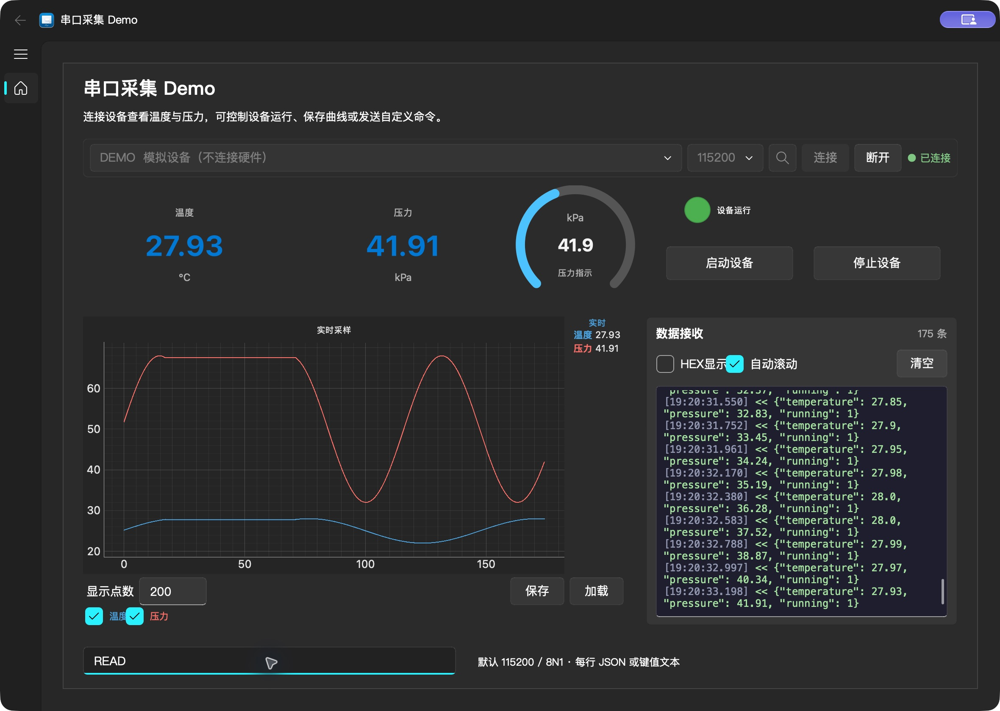

# 独立上位机 Demo

这是设计器实际生成的完整 Python 项目。将整个 `demo` 文件夹复制到其他位置即可运行，不依赖仓库中的 `app` 包，也不需要安装设计器。



## 快速体验

需要 Python 3.10+。在 `demo` 目录创建虚拟环境，安装运行依赖：

```bash
python -m venv .venv
# Windows:
.venv\Scripts\activate
# macOS:
source .venv/bin/activate
python -m pip install -r requirements.txt
python simulate.py
```

根据系统执行对应的一行激活命令。已经安装仓库依赖时，也可以直接在仓库根目录运行 `python demo/simulate.py`。

1. 端口选择 `DEMO`，点击「连接」。
2. 温度、压力、设备运行灯和两条曲线每 200 ms 更新，右侧显示原始接收数据。
3. 点击「停止设备」，运行灯熄灭，数值保持；点击「启动设备」恢复变化。
4. 在底部命令框输入 `READ` 并回车，立即返回一帧；也支持 `START`、`STOP`。
5. 曲线可隐藏单个通道、保存或加载 CSV/JSON。需要保留数据时，在清空曲线或关闭程序前保存。
6. 点击「断开」后停止接收；可以重新连接。

模拟入口只替换串口设备，仍使用导出程序的真实读取线程、行解析器、数据绑定和命令发送代码。它不会打开硬件串口。界面标题中的 Demo 表示这是示例数据面板。

## 连接真实设备

```bash
python main.py
```

选择实际串口，再点击「连接」。默认参数为 **115200、8 数据位、无校验、1 停止位、无流控**。设备每行发送一个 JSON 对象，以实际 LF 或 CRLF 结束：

```json
{"temperature":25.30,"pressure":50.20,"running":1}
```

`temperature` 为 °C，`pressure` 为 kPa，`running` 为 0 或 1。也支持 `temperature=25.30,pressure=50.20,running=1` 行文本。按钮及命令框发送的文本以 CRLF 结束：

| 操作 | 发送内容 |
| --- | --- |
| 启动设备 | `START\r\n` |
| 停止设备 | `STOP\r\n` |
| 命令框输入 READ 并回车 | `READ\r\n` |

真实固件需要实现对应协议，或在设计器里修改绑定和命令后重新导出。

## 文件与修改

| 文件 | 用途 |
| --- | --- |
| `project.uidp` | 可用设计器「打开」继续编辑的源工程 |
| `main.py` | 生成的真实串口程序入口 |
| `ui.py` | 生成的界面、图表和控件 |
| `serial_handler.py` | 生成的串口线程及协议解析器 |
| `data_binding.py` | 生成的数据绑定 |
| `theme_support.py` | 生成的浅色、深色及跟随系统主题支持 |
| `requirements.txt` | 独立运行依赖，不需要 Nuitka |
| `simulate.py` | 手写的可选模拟设备入口 |
| `logo.png` / `logo.ico` | 随导出复制的应用图标 |

本示例以「跟随系统」主题导出。可在设计器设置页选择浅色、深色或跟随系统，打开 `project.uidp` 后重新导出。重新导出会覆盖生成的 Python 文件；业务扩展建议另建模块，`simulate.py` 即为示例。

开发者在仓库根目录验证示例：

```bash
python -m unittest discover -s tests -p test_demo.py -v
```

测试会检查生成产物是否与源工程一致，并把示例复制到仓库外启动，验证接收、显示、命令和重新连接。原生窗口已在 macOS 验证；真实硬件通信仍需按设备协议联调。
